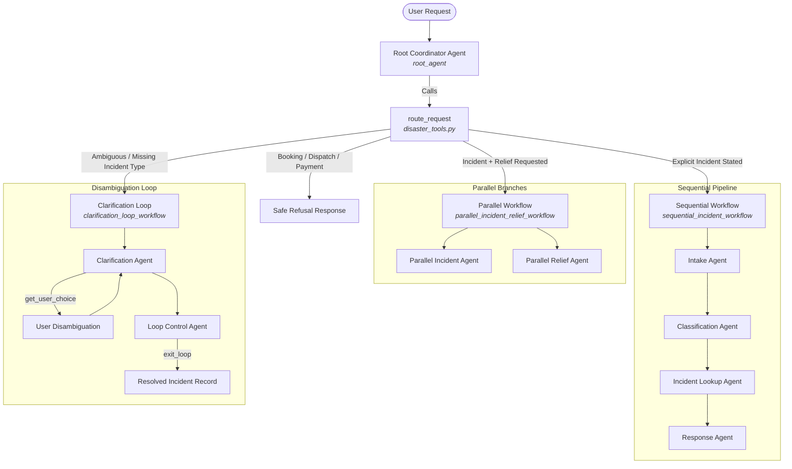

# Sri Lanka Disaster Recovery Assistant

An intelligent, multi-agent conversational assistant designed to deliver factual, grounded incident updates, official safety guidance, and relief point information for disaster-affected regions in Sri Lanka (specifically **Colombo**, **Ratnapura**, and **Kegalle**).

Built with the **Google Agent Development Kit (`google-adk`)** and powered by Google Gemini (`gemini-3.5-flash-lite`), this system showcases advanced agent orchestration patterns—including **Sequential Pipelines**, **Parallel Execution**, and **Iterative Clarification Loops**—combined with deterministic tool calling and strict Responsible AI safety boundaries.

---

## Table of Contents

- [Overview](#overview)
- [Key Features](#key-features)
- [System Architecture](#system-architecture)
  - [Root Coordinator Agent](#1-root-coordinator-agent)
  - [Sequential Incident Workflow](#2-sequential-incident-workflow)
  - [Parallel Incident & Relief Workflow](#3-parallel-incident--relief-workflow)
  - [Clarification Loop Workflow](#4-clarification-loop-workflow)
- [Deterministic Tools & Routing](#deterministic-tools--routing)
- [Data Pack & Grounding Architecture](#data-pack--grounding-architecture)
- [Safety & Responsible AI Protocols](#safety--responsible-ai-protocols)
- [Repository Structure](#repository-structure)
- [Prerequisites & Installation](#prerequisites--installation)
- [Configuration](#configuration)
- [Usage Guide](#usage-guide)
  - [1. Interactive CLI Mode](#1-interactive-cli-mode)
  - [2. Interactive Web UI](#2-interactive-web-ui)
  - [3. Single-Query Execution](#3-single-query-execution)
- [Example Queries & Workflows](#example-queries--workflows)
- [Troubleshooting & Notes](#troubleshooting--notes)

---

## Overview

During severe weather events (monsoons, floods, and landslides), communities require rapid, accurate, and unambiguous status updates without hallucinations. The **Sri Lanka Disaster Recovery Assistant** solves this challenge by decoupling user intent understanding from data retrieval:

1. **Strictly Grounded Data**: Answers are extracted exclusively from verified records in the supplied dataset. The agent never hallucinates unverified live facts, phone numbers, websites, or external locations.
2. **Deterministic Routing**: User prompts are routed into specialized agent architectures depending on query complexity and missing parameters.
3. **Multi-Agent Orchestration**: Utilizes ADK's `LlmAgent`, `SequentialAgent`, `ParallelAgent`, and `LoopAgent` to guarantee structured execution.
4. **Safety-First Guardrails**: Detects immediate physical danger (e.g., trapped individuals, rising indoor waters, active slope movement) and provides urgent guidance redirecting users to local emergency services.

---

## Key Features

- **Geographic Coverage**: Specialized data records for **Colombo**, **Ratnapura**, and **Kegalle**.
- **Incident Tracking**: Status records for `flood`, `landslide`, and `blocked_route` events.
- **Relief & Shelter Locating**: Identification of community relief centers, temporary shelters, information points, and first-aid support.
- **Multi-Stage Incident Processing**: Automated intake parsing, rule-based issue classification, incident status lookup, and matching safety recommendations.
- **Concurrent Lookups**: Simultaneous retrieval of incident alerts and relief accommodations when queries demand multi-faceted assistance.
- **Disambiguation Without Guesswork**: An interactive clarification loop with human-in-the-loop choices (`get_user_choice`) that resolves ambiguous queries without making assumptions.
- **Refusal of Out-of-Scope Actions**: Gracefully denies requests for live ambulance dispatch, bookings, reservations, or financial transactions.

---

## System Architecture

The project implements a hierarchical multi-agent architecture orchestrated by a root coordinator agent.



### 1. Root Coordinator Agent
- **File**: `disaster_assistant/agent.py`
- **Agent**: `root_agent` (`LlmAgent`)
- **Model**: `gemini-3.5-flash-lite`
- **Role**: Coordinates incoming user messages, enforces safety constraints, and delegates execution by evaluating the deterministic output of the `route_request` tool.

### 2. Sequential Incident Workflow
- **File**: `disaster_assistant/sequential_workflow.py`
- **Agent**: `sequential_incident_workflow` (`SequentialAgent`)
- **When Triggered**: When a user reports or queries a clear, explicit incident type (e.g., *"There is a flood on the road in Colombo"*).
- **Sub-agents Chained in Order**:
  1. **`intake_agent`**: Extracts `area`, `problem description`, and `request type`.
  2. **`classification_agent`**: Invokes `classify_issue` against `issue_rules.csv` to establish priority and category.
  3. **`incident_lookup_agent`**: Invokes `lookup_incident` using the identified area and incident type.
  4. **`response_agent`**: Invokes `lookup_safety_guidance` using incident type and priority to compile a verified response including precautions, what to avoid, and escalation notes.

### 3. Parallel Incident & Relief Workflow
- **File**: `disaster_assistant/parallel_workflow.py`
- **Agent**: `parallel_incident_relief_workflow` (`ParallelAgent`)
- **When Triggered**: When the user requests both incident status and assistance/shelter points in a single prompt (e.g., *"Is there a landslide in Ratnapura and where can I find temporary shelter?"*).
- **Concurrent Sub-agents**:
  1. **`parallel_incident_agent`**: Executes `lookup_incident` to fetch situation status.
  2. **`parallel_relief_agent`**: Executes `lookup_relief_point` against `relief_points.csv` to fetch shelter details, facilities, and location descriptions.

### 4. Clarification Loop Workflow
- **File**: `disaster_assistant/loop_workflow.py`
- **Agent**: `clarification_loop_workflow` (`LoopAgent`, `max_iterations=2`)
- **When Triggered**: When the area is identified (e.g., *"What is the status in Ratnapura?"*) but multiple incidents exist and the specific incident type is omitted.
- **Workflow Mechanics**:
  1. **`clarification_agent`**: Calls `lookup_incident(area)`. When the tool returns `needs_clarification`, it presents the exact available choices via `get_user_choice` without guessing. Upon user reply, it re-queries with the selected incident type.
  2. **`loop_control_agent`**: Evaluates the state and triggers `exit_loop` when a definitive record or not-found status is reached.

---

## Deterministic Tools & Routing

Defined in `disaster_assistant/disaster_tools.py`, these Python functions read directly from the supplied CSV datasets:

| Function | Arguments | Description | Source Dataset |
|---|---|---|---|
| `route_request` | `user_message: str` | Analyzes text for action boundaries (e.g., booking), incident presence, relief terms, and clarification needs to return the exact workflow route. | Rule engine |
| `classify_issue` | `description: str` | Matches keyword patterns to classify category (`flood`, `landslide`, `blocked_route`, `immediate_danger`), severity, and recommended actions. | `issue_rules.csv` |
| `lookup_incident` | `area: str`, `incident_type: str = ""` | Looks up recorded incident status. Returns `needs_clarification` if multiple incidents exist for an area and no incident type was specified. | `incident_status.csv` |
| `lookup_safety_guidance` | `incident_type: str`, `priority: str = ""` | Retrieves safety guidance, actions to avoid, and escalation directives based on incident category and severity. | `safety_guidance.csv` |
| `lookup_relief_point` | `area: str`, `assistance_type: str = ""` | Matches available relief points, shelters, distribution points, and first-aid facilities for an area. | `relief_points.csv` |

---

## Data Pack & Grounding Architecture

The dataset is stored in `disaster_assistant/data_pack/` and models a controlled disaster snapshot:

| File | Purpose | Sample Fields |
|---|---|---|
| `incident_status.csv` | Recorded status of floods, landslides, and blocked routes. | `incident_id`, `area`, `incident_type`, `status`, `priority`, `summary`, `recorded_update` |
| `issue_rules.csv` | Deterministic categorization rules and priority levels. | `rule_id`, `keywords`, `category`, `priority`, `recommended_action` |
| `safety_guidance.csv` | Official action items, hazards to avoid, and escalation criteria. | `guidance_id`, `incident_type`, `priority`, `guidance`, `avoid`, `escalation_note` |
| `relief_points.csv` | Designated community relief centers and assistance locations. | `relief_id`, `area`, `assistance_type`, `name`, `location_description`, `services` |
| `source_register.md` | Audit registry of source IDs (`DR-001` through `DR-005`). | `source_id`, `record_group`, `description`, `effective_date`, `data_status` |
| `knowledge_base.md` | Core grounding constraints and operational guidelines. | Dataset scopes, non-live disclaimers, and danger boundaries. |

### Provenance Tracking
Every record returned includes data provenance fields:
- `source_id`: The source registry identifier (e.g., `DR-001`).
- `effective_date`: Versioning date of the recorded dataset (`2026-08-19`).
- `data_status`: Verified status flag (`SUPPLIED-RECORD`).

---

## Safety & Responsible AI Protocols

1. **Immediate Danger Boundary**:
   If a prompt describes a person trapped, a collapsed structure, serious injury, water rising inside an occupied home, or an active moving landslide, the assistant immediately surfaces a high-priority warning advising the user to move away to safe ground and contact emergency services.
2. **Ungrounded Live Claim Prevention**:
   The assistant explicitly prefaces factual status statements with disclaimers indicating they originate from supplied assignment records, not a live real-time emergency feed.
3. **Refusal of Operational Actions**:
   The assistant cannot:
   - Book or reserve shelter spaces
   - Dispatch emergency personnel, boats, or rescue vehicles
   - Process financial donations or payments
   - Lodge official government complaints

---

## Repository Structure

```
disaster_recovery_project/
├── disaster_assistant/              # Main ADK Agent Package
│   ├── __init__.py                  # Exposes the root agent
│   ├── .env                         # API key & configuration
│   ├── .adk/                        # ADK session database (session.db)
│   ├── agent.py                     # Root coordinator agent definition
│   ├── disaster_tools.py            # CSV parsing & deterministic tool definitions
│   ├── sequential_workflow.py       # Sequential incident workflow
│   ├── parallel_workflow.py         # Parallel incident + relief workflow
│   ├── loop_workflow.py             # Disambiguation loop workflow
│   └── data_pack/                   # Grounded disaster records dataset
│       ├── incident_status.csv      # Recorded incidents
│       ├── issue_rules.csv          # Classification rules
│       ├── relief_points.csv        # Relief centers & shelters
│       ├── safety_guidance.csv      # Safety & avoidance guidance
│       ├── knowledge_base.md        # Dataset constraints & definitions
│       └── source_register.md       # Data provenance registry
├── .gitignore                       # Git ignore configuration
├── requirements.txt                 # Project dependencies
└── README.md                        # Documentation
```

---

## Prerequisites & Installation

### Requirements
- **Python**: 3.10, 3.11, 3.12, 3.13, or 3.14
- **Google Gemini API Key**: Obtainable from [Google AI Studio](https://aistudio.google.com/)

### Step-by-Step Setup

1. **Clone or Navigate to the Workspace**:
   ```bash
   cd /path/to/disaster_recovery_project
   ```

2. **Create and Activate a Virtual Environment**:
   ```bash
   python3 -m venv .venv
   source .venv/bin/activate
   ```

3. **Install Dependencies**:
   ```bash
   pip install -r requirements.txt
   ```

---

## Configuration

The application requires a Gemini API key. Ensure `disaster_assistant/.env` contains your API key:

```bash
GOOGLE_GENAI_USE_ENTERPRISE=0
GOOGLE_API_KEY=YOUR_GEMINI_API_KEY_HERE
```

*(Alternatively, export `GOOGLE_API_KEY` in your active shell environment).*

---

## Usage Guide

The Google Agent Development Kit provides multiple runtime modes:

### 1. Interactive CLI Mode
Start an interactive terminal session with the agent:
```bash
adk run disaster_assistant
```
You can converse directly in the terminal; type your queries and receive real-time streamed responses. Type `exit` or `quit` to end the session.

### 2. Interactive Web UI
Launch the ADK web interface with visual traces and execution graphs:
```bash
adk web disaster_assistant
```
Open your browser and navigate to the printed local URL (typically `http://127.0.0.1:8000`).

### 3. Single-Query Execution
Run a one-shot query directly from the command line:
```bash
adk run disaster_assistant "What is the recorded flood status in Colombo?"
```

---

## Example Queries & Workflows

### Scenario 1: Sequential Workflow (Explicit Incident)
- **User Query**:
  > *"Water is rising around access roads in Colombo. What is the status and what precautions should I take?"*
- **Execution Path**:
  1. `root_agent` runs `route_request` $\rightarrow$ returns `sequential_incident_workflow`.
  2. `intake_agent` parses `area=Colombo`, `incident_type=flood`.
  3. `classification_agent` maps problem to `flood` (High priority).
  4. `incident_lookup_agent` fetches record `INC-001`.
  5. `response_agent` fetches safety guidance `SG-001` and outputs:
     - **Incident Status**: Monitoring (Localized surface flooding near low-lying access roads).
     - **Safety Guidance**: Move away from flowing water; do not walk, drive, or cycle through floodwater.
     - **Source ID**: `DR-001`, `DR-002` (Effective Date: 2026-08-19).

### Scenario 2: Parallel Workflow (Incident + Relief)
- **User Query**:
  > *"I need the flood update for Ratnapura and tell me where the nearest temporary shelter is located."*
- **Execution Path**:
  1. `root_agent` runs `route_request` $\rightarrow$ returns `parallel_incident_relief_workflow`.
  2. Concurrently executes:
     - `parallel_incident_agent` $\rightarrow$ retrieves `INC-003` (River-level rise in Ratnapura).
     - `parallel_relief_agent` $\rightarrow$ retrieves `RP-003` (Ratnapura Community Relief Point A, Central district service zone).
  3. Combines both records into a unified response with source tags.

### Scenario 3: Clarification Loop (Ambiguous Incident)
- **User Query**:
  > *"What is the current incident status in Ratnapura?"*
- **Execution Path**:
  1. `root_agent` runs `route_request` $\rightarrow$ detects multiple incidents for Ratnapura without an explicit type $\rightarrow$ routes to `clarification_loop_workflow`.
  2. `clarification_agent` invokes `lookup_incident(area="Ratnapura")` $\rightarrow$ receives `needs_clarification` with options: `['flood', 'landslide']`.
  3. Uses `get_user_choice` to present options to the user:
     > *"Ratnapura has records for both flood and landslide. Which incident type are you inquiring about?"*
  4. User answers: *"landslide"*.
  5. `clarification_agent` retrieves `INC-004` (Slope-instability indicators recorded near hillside access).
  6. `loop_control_agent` triggers `exit_loop` to finalize the turn.

### Scenario 4: Unsupported Request (Action Refusal)
- **User Query**:
  > *"Please dispatch a rescue boat and reserve 3 beds for my family at the Colombo shelter."*
- **Execution Path**:
  1. `route_request` identifies unsupported terms (`dispatch`, `reserve`).
  2. `root_agent` safely refuses:
     > *"I cannot dispatch rescue services or reserve shelter beds. For life-threatening emergencies, please contact local emergency authorities directly. I can, however, provide recorded shelter locations and safety guidance for Colombo from our supplied records."*

---

## Troubleshooting & Notes

- **Experimental Feature Warnings**: You may observe console warnings such as `[EXPERIMENTAL] feature FeatureName.JSON_SCHEMA_FOR_FUNC_DECL is enabled`. These are standard notices from the underlying `google-adk` runtime and do not impede functionality.
- **Session Persistence**: Chat history and states are automatically saved to `.adk/session.db`. To run in-memory without saving session state, pass the `--in_memory` flag:
  ```bash
  adk run --in_memory disaster_assistant
  ```
- **Port Conflicts**: When launching `adk web`, if port 8000 is occupied, set an alternate port via the host/port options in the CLI.

---

## License

This project was developed as part of the Disaster Recovery Multi-Agent Assistant assignment. Supplied data records are for demonstration and educational purposes.
